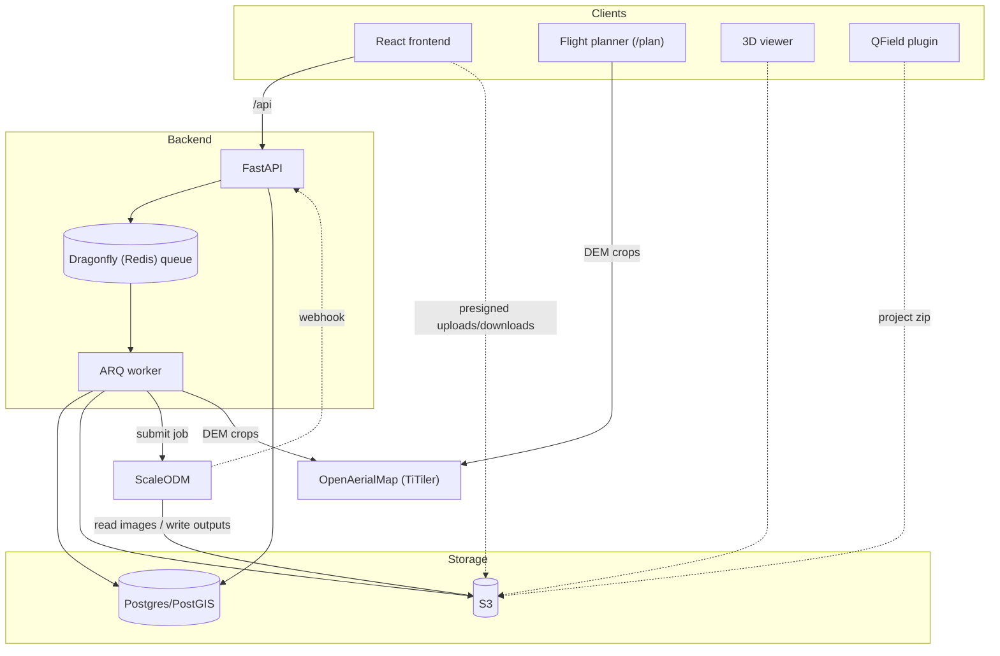
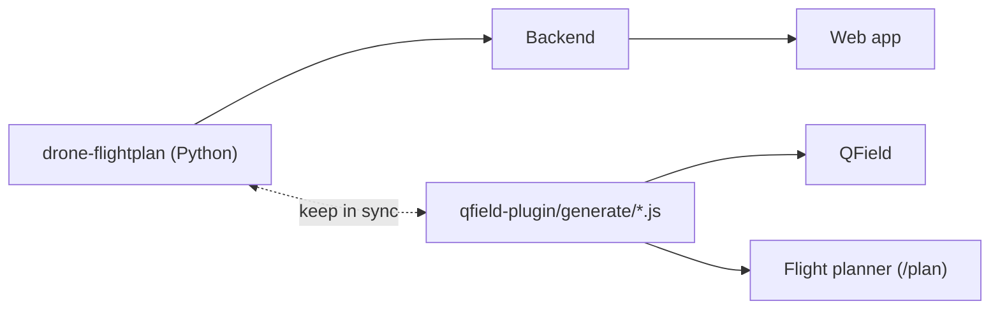
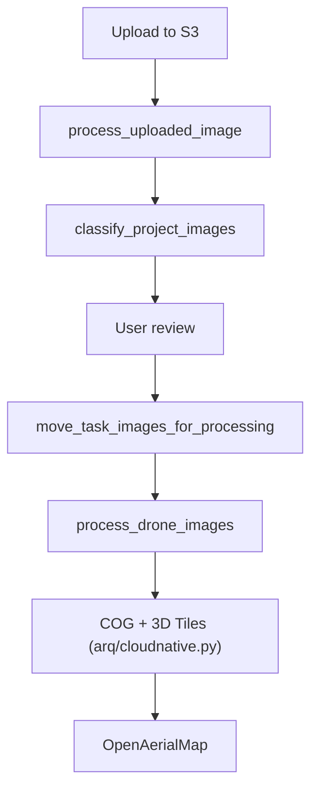

# Architecture

DroneTM helps teams plan drone flights, collect imagery and process it into maps.
The main web app is built with React and Vite, and talks to a FastAPI backend.
Postgres/PostGIS stores the project data, S3 holds imagery and other files,
and ARQ workers handle background jobs through a Dragonfly (Redis-compatible)
queue.

Imagery moves directly between the browser and S3 using presigned URLs.
ScaleODM also reads images from S3 and writes its processed results there.
The API handles the metadata and controls access to these files.

In production:

- Uploads go through S3 Transfer Acceleration, using AWS's edge network for
  faster uploads from anywhere in the world.
- Downloads are served through CloudFront.
- The bucket uses S3 Intelligent-Tiering, so old imagery moves to cheaper
  storage automatically.

S3 layout, per project:

| Key                                    | Contents                           |
| -------------------------------------- | ---------------------------------- |
| `projects/{project}/dem.tif`           | Terrain model for flightplans      |
| `projects/{project}/user-uploads/`     | Raw uploads, before they're sorted |
| `projects/{project}/{task}/images/`    | A task's imagery, ready for ODM    |
| `projects/{project}/{task}/odm/`       | ODM outputs for one task           |
| `projects/{project}/odm/`              | ODM outputs for the whole project  |
| `publicuploads/cloudnative/{project}/` | Web-ready COG and 3D Tiles         |

For local development, Docker Compose runs the stack. Kubernetes deployments
use the Helm chart in `chart/`.

## Code layout

| Path                                     | Purpose                                                                                  |
| ---------------------------------------- | ---------------------------------------------------------------------------------------- |
| `src/backend/app/`                       | API, background jobs and database migrations                                             |
| `src/backend/packages/drone-flightplan/` | Python flightplan generator used by the backend                                          |
| `src/frontend/src/`                      | Main web app                                                                             |
| `src/flight-planner/`                    | Offline browser flightplan generator at `/plan`                                          |
| `src/qfield-plugin/`                     | Offline flightplan generator for QField on mobile, sharing code with the browser planner |
| `src/drone-mesh/`                        | three.js viewer for processed 3D models                                                  |
| `src/gcp-editor/`                        | Ground control point editor web component                                                |

## Backend

The backend is organised into domain folders such as `projects/` and `tasks/`,
each with the same files:

| File           | Role                                   |
| -------------- | -------------------------------------- |
| `*_routes.py`  | HTTP endpoints, kept thin              |
| `*_logic.py`   | Business logic                         |
| `*_schemas.py` | Pydantic models, plus database methods |
| `*_deps.py`    | FastAPI dependencies for the routes    |

Database queries use raw SQL through the async psycopg pool in `db/database.py`.
Each request gets a single connection and transaction, with `class_row` mapping
the query results directly to Pydantic models. The SQLAlchemy models in
`db/db_models.py` are used only for Alembic migrations. Shared enums live in
`db/enums.py`.

Authentication uses HOT single sign-on via Hanko, in `users/user_deps.py`
(legacy auth using Google OAuth only is also possible for now).

Background jobs live in `arq/tasks.py`. `WorkerSettings` lists every job
function and the cron schedules.

## Main workflows

### Projects and tasks

A project contains task polygons, which can be generated by splitting an area
or uploaded by the user. As work progresses, each task's state comes from the
latest entry in the append-only `task_events` log. The states are described
in `State` in `db/enums.py`.

### Flightplans

Flightplans can be generated by the backend, in QField or in the offline browser
planner. The backend uses the Python `drone-flightplan` package, while QField
and the browser planner share the JavaScript in `qfield-plugin/generate/*.js`.
The Python and JavaScript implementations need to stay in sync.
`qfield-plugin/test_compare.py` and `flight-planner/tests/` check parity.

For terrain following, the generators sample a project's digital elevation
model (DEM). By default this is GLO-30 served through
[OpenAerialMap](https://api.imagery.hotosm.org/browser/stac/collections/cop-dem-glo-30)
(TiTiler), with JAXA or a user-uploaded DEM as alternatives. QField
bundles the DEM, while the browser planner caches it so it is available offline.

### Imagery

After a flight, users upload their images to S3. Workers read the metadata and
check image quality, and the images are matched to tasks for the user to review.
Once approved, the images go to ScaleODM for processing. The workflow then
continues with COG and 3D Tiles conversion and a final upload to OpenAerialMap.

The [upload workflow](imagery-upload.md) describes this in more detail.

### Processing status

To keep the project status up to date, `reconcile_project_processing` in
`projects/project_logic.py` checks for the output orthophoto in S3, then asks
ScaleODM (web API) whether the job failed or is still running. It runs when:

1. ScaleODM sends a webhook.
2. A project page is opened or refreshed.
3. The 30-minute cron runs.

A separate nightly job resumes stalled image transfers.

## Frontend

The frontend keeps server data in TanStack Query, with hooks in `src/api/`
calling the axios services in `src/services/`. UI state is held in Redux Toolkit
slices under `src/store/slices/`, and routes are defined in
`src/routes/appRoutes.ts`.

Maps use MapLibre with mapbox-gl-draw for drawing geometries. Uppy handles
multipart uploads to S3, and there is an experimental WebADB (`src/utils/adb.ts`)
implementation for transferring flightplans to controllers (but it requires
USB debugging to be enabled in Android dev settings...).

Each frontend part is built a little differently:

| Part           | Built with                                              |
| -------------- | ------------------------------------------------------- |
| Main web app   | React, TanStack Query, Redux Toolkit                    |
| Flight planner | Vanilla TypeScript + MapLibre, a standalone offline PWA |
| GCP editor     | Lit, compiled to a framework-free web component         |
| 3D viewer      | Vanilla JS + three.js                                   |
| QField plugin  | QML + plain JS                                          |

The web parts build with Vite, except the GCP editor (esbuild). The main app,
flight planner and GCP editor share `@hotosm/ui` web components.

For local setup, see [Development Setup](setup.md). For the reasoning behind
these choices, see the [architecture decisions](../decisions/README.md).
